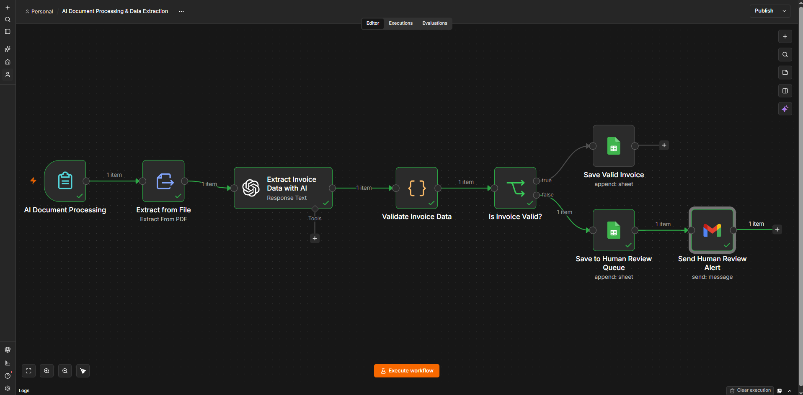
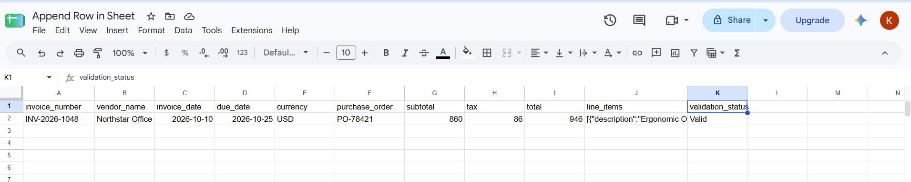
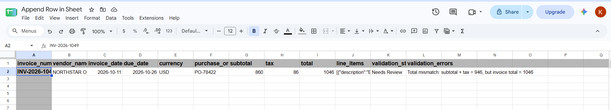
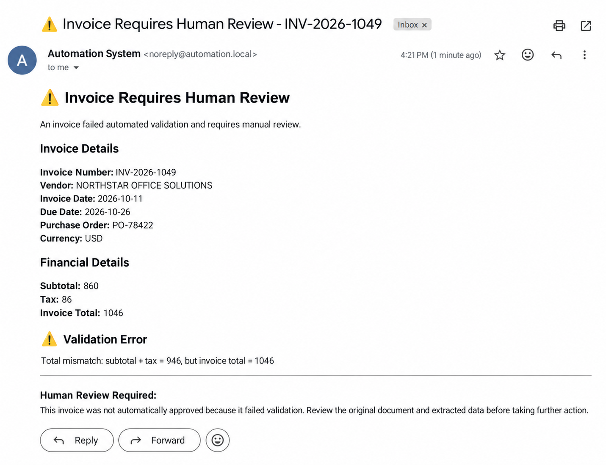

# AI Document Processing & Data Extraction

An AI-assisted document processing workflow built with **n8n, OpenAI, Google Sheets, and Gmail** that extracts structured invoice data from uploaded PDF documents, validates financial information, and routes invoices based on validation results.

The workflow demonstrates how unstructured business documents can be converted into structured operational data while keeping human review in the loop when validation fails.

## Business Problem

Invoices and other business documents often arrive as PDFs containing information that must be manually reviewed and entered into business systems.

Manual processing can be repetitive and introduces the possibility of data-entry errors.

This project explores an automated workflow that:

- Accepts invoice PDF uploads
- Extracts text from the document
- Uses AI to convert unstructured invoice text into structured data
- Validates extracted financial information
- Separates valid invoices from invoices requiring review
- Stores processing results in Google Sheets
- Sends an internal alert when human review is required

## Workflow Architecture



The workflow follows this general architecture:

```text
PDF Upload
    ↓
Extract Text from PDF
    ↓
AI Structured Data Extraction
    ↓
Invoice Validation
    ↓
Is Invoice Valid?
   ↙             ↘
Yes               No
 ↓                 ↓
Valid Invoice      Human Review Queue
Storage             ↓
                 Gmail Alert
```

## How It Works

### 1. PDF Invoice Upload

The workflow begins with an **n8n Form Trigger** that allows a user to upload an invoice document.

The form is configured to accept PDF files.

### 2. PDF Text Extraction

The **Extract from File** node reads the uploaded PDF and extracts its textual content.

This converts the uploaded document into text that can be processed by the AI extraction step.

### 3. AI Invoice Data Extraction

The extracted invoice text is sent to an OpenAI model.

The model converts the unstructured document into a defined structured schema containing fields such as:

- Invoice number
- Vendor name
- Invoice date
- Due date
- Currency
- Purchase order
- Subtotal
- Tax
- Total
- Line items

Each line item contains:

- Description
- Quantity
- Unit price
- Amount

Structured output is used so downstream workflow nodes can process predictable fields rather than free-form AI responses.

### 4. Invoice Validation

After extraction, a validation step checks the structured invoice data.

The validation logic verifies important conditions including the relationship between:

```text
Subtotal + Tax = Invoice Total
```

The workflow then adds validation information including:

- `is_valid`
- `validation_status`
- `validation_errors`

### 5. Conditional Routing

The **Is Invoice Valid?** node routes the invoice according to its validation result.

Valid invoices follow the automated storage path.

Invoices that fail validation are routed to a separate human-review process.

## Valid Invoice Processing

When an invoice passes validation, its structured data is stored in Google Sheets.



The stored record includes the extracted invoice information, serialized line-item data, and validation status.

This test verified a valid invoice where:

```text
Subtotal: 860
Tax:       86
Total:     946
```

Because:

```text
860 + 86 = 946
```

the invoice successfully passed validation.

## Human Review Routing

The workflow was also tested with an invoice containing inconsistent financial data.

The test invoice contained:

```text
Subtotal: 860
Tax:       86
Total:     1046
```

The expected total was:

```text
860 + 86 = 946
```

Because the invoice reported `1046`, the validation step detected the mismatch.

The invoice was marked:

```text
Needs Review
```

with the validation error:

```text
Total mismatch: subtotal + tax = 946, but invoice total = 1046
```

The invoice was then routed to the Human Review Queue.



## Human Review Alert

Invoices that fail validation also trigger an internal Gmail notification.



The alert contains relevant invoice information and the validation error so that a reviewer can investigate the original document before taking further action.

The alert explicitly indicates that the invoice was **not automatically approved**.

## Human-in-the-Loop Design

This workflow intentionally separates AI extraction from deterministic validation.

The AI model is responsible for converting document text into structured invoice fields.

Business-rule validation is then performed separately before the invoice is accepted.

If validation fails, the workflow does not attempt to correct or approve the invoice automatically. Instead, it:

1. Marks the invoice as requiring review
2. Stores it in a Human Review Queue
3. Sends an internal review notification

This provides a safer pattern for using AI in document-processing workflows where extracted information can affect business operations.

## Testing & Verification

The workflow was tested with both valid and invalid invoice scenarios.

| Test | Expected Result | Verified Result |
|---|---|---|
| PDF invoice upload | File accepted by form | Passed |
| PDF text extraction | Invoice text extracted | Passed |
| AI structured extraction | Invoice fields returned in structured format | Passed |
| Valid financial totals | Invoice marked Valid | Passed |
| Valid invoice routing | Sent to valid invoice storage | Passed |
| Incorrect invoice total | Validation failure detected | Passed |
| Invalid invoice routing | Sent to Human Review Queue | Passed |
| Human review notification | Gmail alert generated | Passed |

## Example Extracted Data

A successful extraction produced structured information similar to:

```json
{
  "invoice_number": "INV-2026-1048",
  "vendor_name": "Northstar Office Solutions",
  "invoice_date": "2026-10-10",
  "due_date": "2026-10-25",
  "currency": "USD",
  "purchase_order": "PO-78421",
  "subtotal": 860,
  "tax": 86,
  "total": 946,
  "line_items": [
    {
      "description": "Ergonomic Office Chair",
      "quantity": 2,
      "unit_price": 240,
      "amount": 480
    },
    {
      "description": "Wireless Keyboard & Mouse Set",
      "quantity": 3,
      "unit_price": 65,
      "amount": 195
    },
    {
      "description": "USB-C Docking Station",
      "quantity": 1,
      "unit_price": 185,
      "amount": 185
    }
  ]
}
```

The invoice and company information used for testing is demonstration data.

## Tools & Technologies

- **n8n** — workflow orchestration
- **OpenAI** — structured invoice data extraction
- **JavaScript** — deterministic invoice validation
- **Google Sheets** — valid invoice storage and human-review queue
- **Gmail** — internal human-review notifications
- **n8n Forms** — PDF document intake
- **JSON Schema** — structured AI output
- **PDF text extraction** — document preprocessing

## Workflow File

The sanitized n8n workflow is included in this repository:

[View workflow JSON](workflow/ai-document-processing-data-extraction.json)

The public workflow export intentionally excludes private credential references and environment-specific identifiers.

After importing the workflow, users must configure their own:

- OpenAI credentials
- Google Sheets credentials and documents
- Gmail credentials
- Review notification destination

## Limitations

This project is a portfolio demonstration and is not presented as a production invoice-processing system.

Current limitations include:

- AI extraction accuracy depends on document quality and invoice structure.
- The workflow has been tested with the demonstrated invoice format rather than a large heterogeneous invoice dataset.
- Financial validation currently covers defined deterministic checks rather than full accounting or compliance validation.
- Human review is still required when validation fails.
- Google Sheets is used as lightweight demonstration storage rather than a production accounting database.
- AI-extracted values should not be treated as authoritative without appropriate validation.

## Potential Improvements

Future versions could include:

- Duplicate invoice detection
- Vendor validation against an approved vendor database
- Additional financial and tax validation rules
- Confidence scoring for extracted fields
- Support for additional document formats
- OCR handling for scanned/image-based invoices
- ERP or accounting-system integration
- Review approval/rejection workflow
- Processing audit logs
- Error handling and retry logic
- Batch document processing

## Portfolio Status

**Verified — Portfolio Ready**

The core workflow has been implemented and tested with both successful and failed validation scenarios.

Evidence included in this repository demonstrates:

- PDF document intake
- Text extraction
- AI-based structured data extraction
- Deterministic validation
- Conditional routing
- Valid invoice storage
- Human-review queue routing
- Human-review email notification

The project demonstrates an AI-assisted document automation pattern where AI handles unstructured information extraction while deterministic business rules and human review control downstream decisions.
